# ⛪ Système intelligent de gestion du patrimoine de l'Église Méthodiste Unie — Burundi et Rwanda

[](https://github.com/Minyurano/systeme-intelligent-gestion-emu-burundi-rwanda/actions/workflows/ci.yml)


Plateforme web (logiciel **UMURAGE**, « héritage » en kirundi) qui aide une Église à **recenser, valoriser, entretenir et rendre compte** de son patrimoine (terrains, bâtiments, écoles, centres de santé, forages, véhicules, cheptel), de ses finances, de ses dîmes et offrandes et de son registre des membres.

Elle réunit :
- une application de gestion complète ;
- des **déclarations par WhatsApp** depuis le terrain ;
- des **capteurs IoT** ;
- des **modèles d'intelligence artificielle** expliqués à l'utilisateur.

Conçue pour l'**Église Méthodiste Unie du Burundi**, elle accueille sur une même installation plusieurs organisations, chacune avec ses données, sa monnaie et sa langue. Une organisation **EMU Rwanda** (en anglais, en RWF) sert de démonstration.

<p align="center">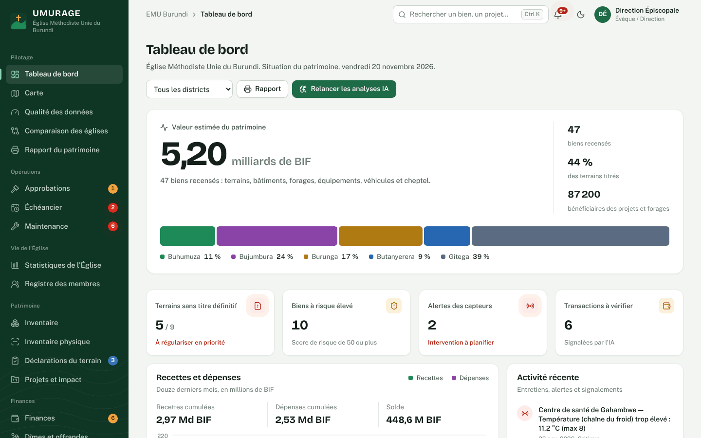</p>

> **Données de démonstration.** Les districts, paroisses, projets et partenaires de l'EMU Burundi viennent de son rapport institutionnel. Les montants, surfaces, transactions, ventes de référence, membres et mesures de capteurs sont **fictifs**, comme l'ensemble de l'organisation « EMU Rwanda ».

---

**Sommaire :** [Fonctionnalités](#fonctionnalités) · [Intelligence artificielle](#intelligence-artificielle) · [Captures d'écran](#captures-décran) · [Démarrage rapide](#démarrage-rapide) · [Architecture](#architecture) · [Sécurité](#sécurité) · [Qualité et tests](#qualité-et-tests) · [Mise en production](#mise-en-production) · [Feuille de route](#feuille-de-route)

## Fonctionnalités

| Domaine | Ce que fait la plateforme |
|---|---|
| **Recenser** | Inventaire avec code unique et **QR code** par bien. **Déclarations par WhatsApp** (texte, photo, vocal) comprises automatiquement et validées en un clic. Import Excel ou CSV. **Mode hors ligne** sur téléphone. |
| **Comprendre** | Tableau de bord par district, carte du patrimoine, qualité des données. **Comparaison des églises par apprentissage automatique**. Statistiques de l'Église. |
| **Gérer** | Circuit d'**approbations** selon le montant (personne ne valide sa propre demande). Échéancier avec rappels WhatsApp. Locations et loyers. Maintenance préventive. Comptabilité du patrimoine (budget, amortissements, rapprochement bancaire). Inventaire physique par scan. |
| **Vie de l'Église** | Registre des membres. **Dîmes et offrandes** avec reçus numérotés et attestation annuelle vérifiable par QR code. **Espace membre** sur téléphone (fiche, carte de membre, dons, signalements). |
| **Rendre des comptes** | Rapport du patrimoine en PDF. **Export IATI 2.03** pour les bailleurs. Export comptable. Portail public sans donnée sensible. **Journal d'audit scellé** (chaîne d'empreintes SHA-256). |
| **Passer à l'échelle** | Multi-organisations (BIF, RWF, KES…) avec cloisonnement vérifié par des tests. Inscription d'une nouvelle Église en libre-service. Interface en français et en anglais. |

Description complète module par module et routes de l'API : [docs/FONCTIONNALITES.md](docs/FONCTIONNALITES.md).

## Intelligence artificielle

Les modèles sont entraînés **séparément pour chaque organisation**, car chaque marché foncier et chaque monnaie est différent. Chaque résultat est **expliqué** à l'utilisateur : facteurs, fourchette, niveau de fiabilité.

| Module | Usage | Méthode |
|---|---|---|
| Valorisation des biens | Valeur estimée d'un terrain ou d'un bâtiment, avec fourchette et facteurs | **Forêt aléatoire** entraînée sur des ventes comparables (R² = 0,90 sur la démonstration) ; amortissement linéaire pour les équipements et véhicules |
| Anomalies financières | Transactions à vérifier, avec le motif (« montant 6,4 fois supérieur à l'habitude… ») | **Isolation Forest** sur des caractéristiques comparées aux habitudes de chaque catégorie et district |
| Prévisions financières | Recettes et dépenses à six mois, avec fourchette à 80 % | Tendance linéaire et saisonnalité mensuelle ; les mois encore incomplets sont écartés du calcul |
| Risque et maintenance | Biens à inspecter en priorité | Score explicable de 0 à 100 (état, âge, entretien, alertes des capteurs, statut juridique des terrains) ; inspection planifiée automatiquement au-delà du seuil |
| Messages du terrain | « Le toit de l'école de Nyabugogo fuit » → bien existant, état, catégorie | Analyse du langage (vocabulaire métier, paroisses, montants) avec indice de confiance, rapprochement avec l'inventaire ; transcription des vocaux avec faster-whisper (kirundi, français, swahili) |
| Assistant | Réponses sur le patrimoine, avec citation des sources | Recherche augmentée (RAG) : index **TF-IDF** des documents et faits structurés ; modèle de langage facultatif |
| **Comparaison des églises** | Profils, églises atypiques, jumelages | **ACP** (carte des églises), **k-moyennes** (nombre de groupes choisi par silhouette), **régression ridge** en validation croisée (indice attendu à contexte égal), **auto-encodeur 8-3-8** (profils atypiques), **plus proches voisins** (églises jumelles) |

<p align="center">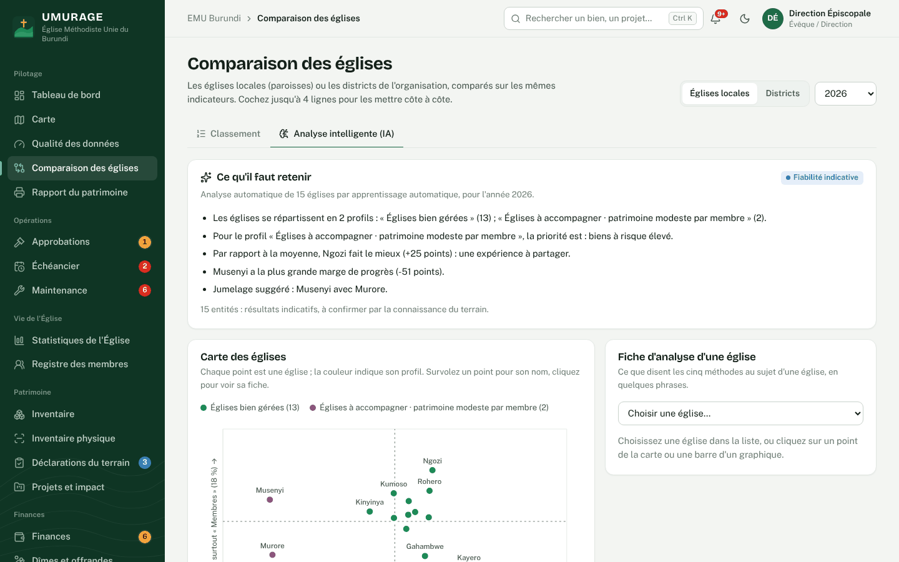</p>

## Captures d'écran

| | |
|---|---|
| 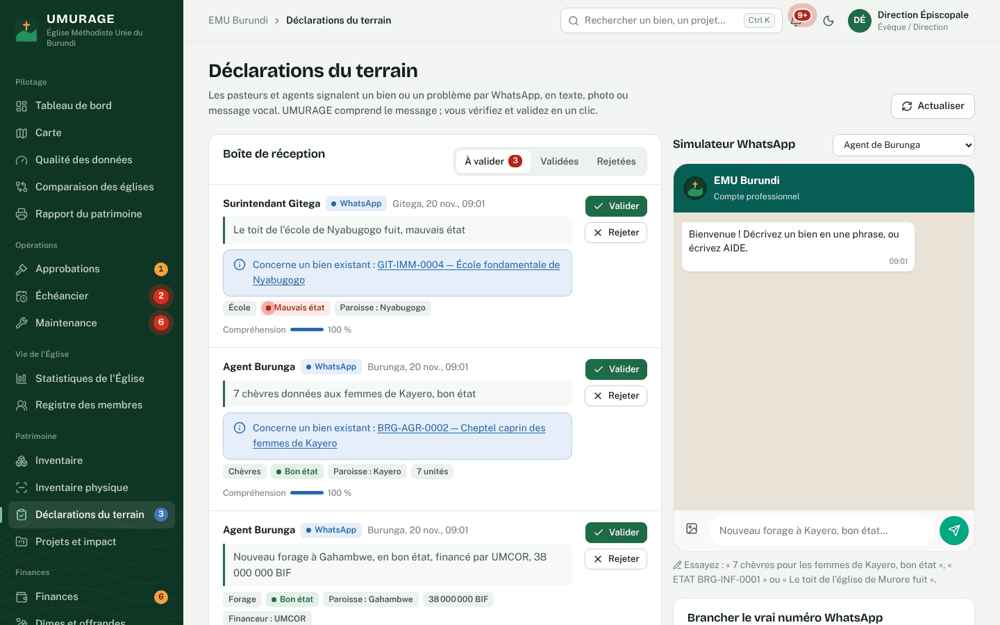<br><sub><b>Déclarations du terrain</b> : messages WhatsApp compris et rattachés à un bien existant, simulateur intégré</sub> | 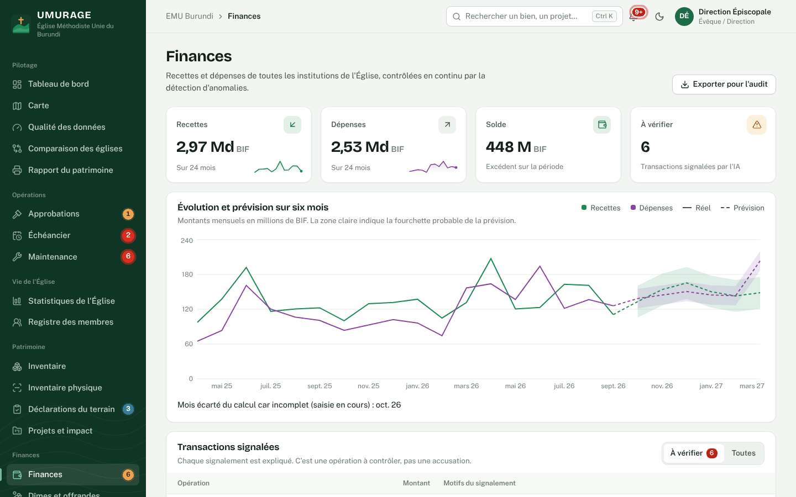<br><sub><b>Finances</b> : prévision sur six mois et transactions signalées par l'IA</sub> |
| 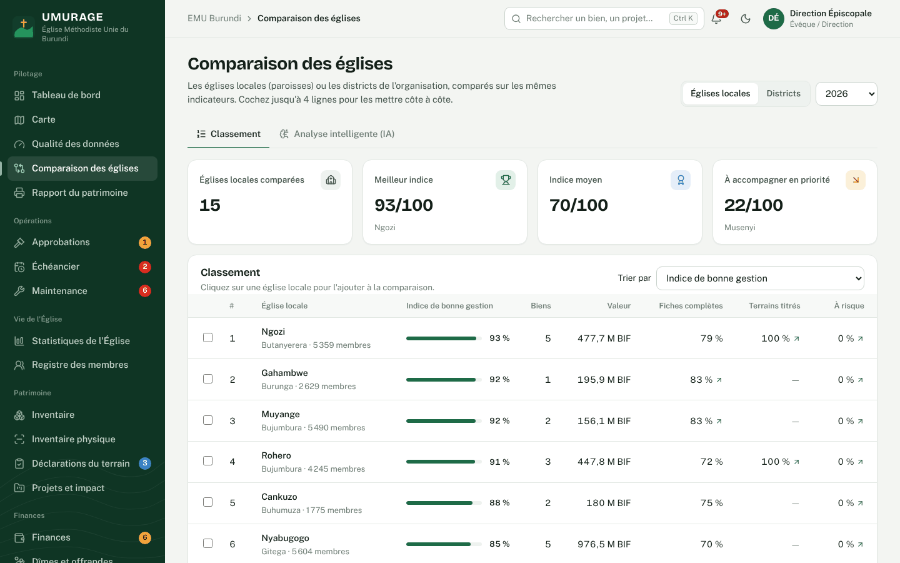<br><sub><b>Comparaison des églises</b> : indice de bonne gestion et écarts à la moyenne</sub> | 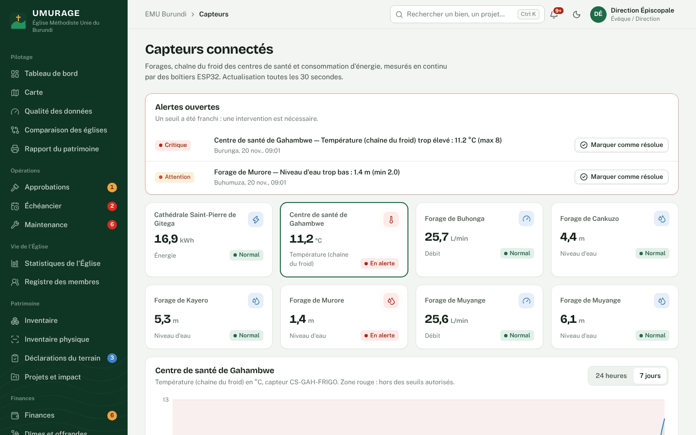<br><sub><b>Capteurs IoT</b> : forages et chaîne du froid des centres de santé</sub> |
| 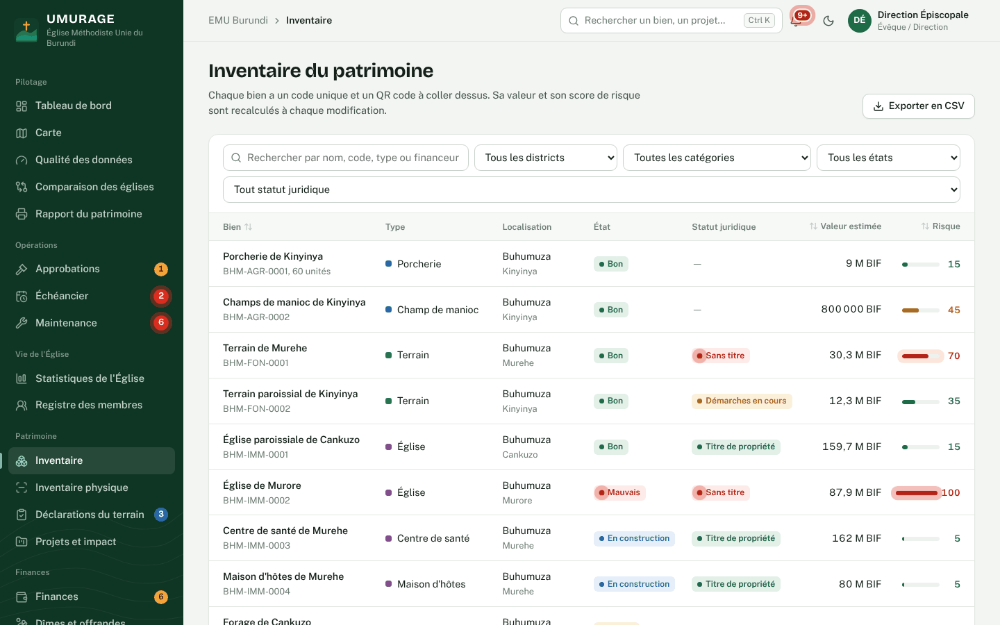<br><sub><b>Inventaire</b> du patrimoine, avec filtres et QR codes</sub> | 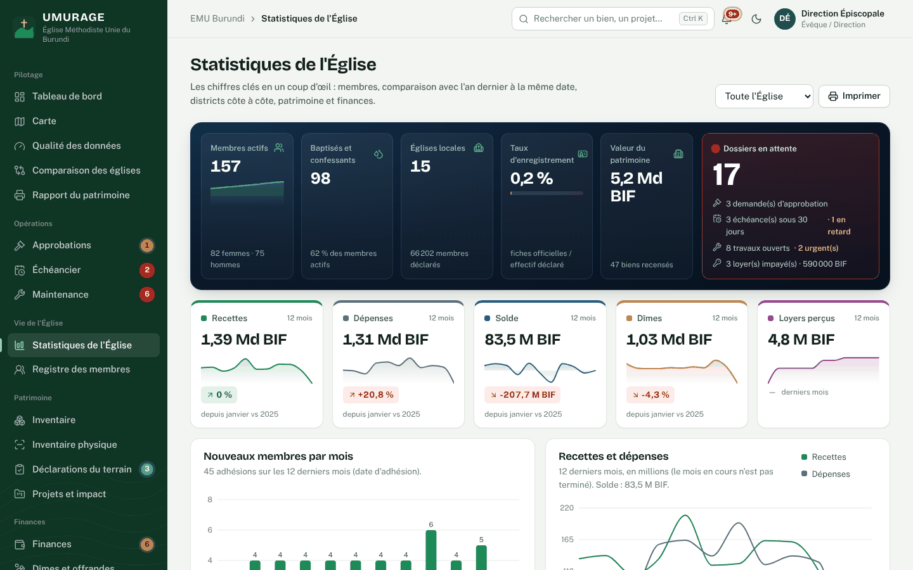<br><sub><b>Statistiques de l'Église</b> : membres, dîmes, évolution</sub> |

<p align="center">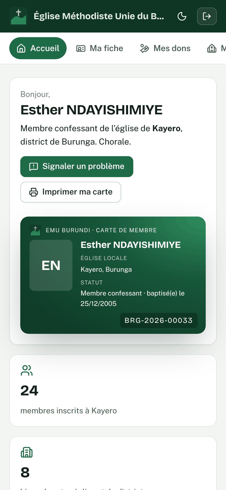&nbsp;&nbsp;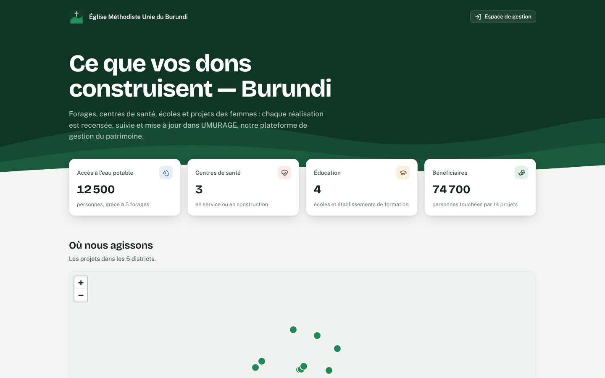</p>
<p align="center"><sub><b>Espace membre</b> sur téléphone · <b>Portail public</b> de l'organisation, sans donnée financière ni titre de propriété</sub></p>

## Démarrage rapide

Prérequis : **Python 3.11+** et **Node.js 18+**.

```powershell
# Windows (PowerShell, à la racine du projet)
powershell -ExecutionPolicy Bypass -File .\demarrer-windows.ps1
```
```bash
# Linux ou macOS
sh demarrer.sh
```

Le script installe ce qui manque, prépare la base et les données de démonstration, construit l'interface et ouvre **http://localhost:8000**. Un seul serveur sert l'interface et l'API.

| Identifiant (mot de passe `umurage2026`) | Rôle |
|---|---|
| `eveque` | Direction : voit et pilote tout le patrimoine |
| `tresorier` | Finances et contrôle des anomalies |
| `surintendant.gitega` | Limité au district de Gitega, valide les déclarations |
| `agent.burunga` | Recense les biens de Burunga, déclare par WhatsApp |
| `admin` | Comptes, rôles, districts, intégrations |
| `admin.rwanda` | Deuxième organisation (en anglais, en RWF) : données totalement séparées |
| `membre.kayero` | Membre de l'Église : espace membre uniquement |

Ces comptes ne sont affichés **qu'en mode démonstration**, jamais en production.

Pour recharger toute la démonstration, lancez `python manage.py seed_demo --reset` dans `backend`. **Attention : cette commande efface les données existantes.**

## Architecture

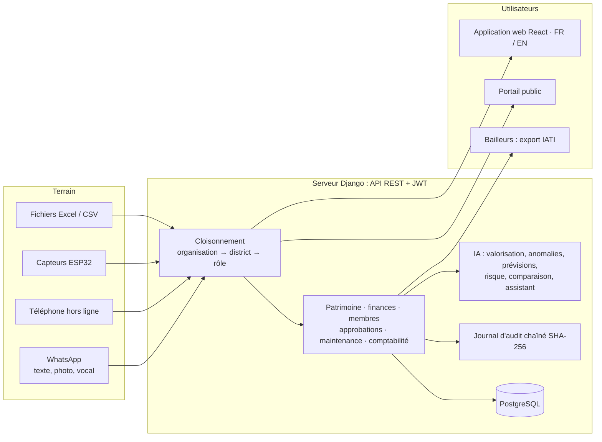

| Partie | Technologies |
|---|---|
| Serveur | Python, Django 5, Django REST Framework, JWT (jeton court en mémoire, rafraîchissement par cookie HttpOnly), PostgreSQL ou SQLite |
| IA | scikit-learn, NumPy ; faster-whisper (facultatif) pour les vocaux |
| Interface | React 18, Vite, Recharts, Leaflet ; application installable (PWA) avec mode hors ligne |
| Exploitation | Docker, Caddy (HTTPS automatique), sauvegardes quotidiennes, contrôle de santé, Sentry ou GlitchTip (facultatif) |

```
backend/
├── config/      paramètres, routes, service de l'interface
├── core/        organisations, districts, rôles, cloisonnement, journal, inscription, membres
├── patrimoine/  biens, documents, projets, déclarations, WhatsApp, import / export, qualité
├── finances/    transactions
├── metier/      approbations, échéancier, locations, maintenance, comptabilité, dîmes, comparaison des églises
├── iot/         capteurs, mesures, alertes
└── ia/          valorisation, anomalies, prévisions et risque, assistant
frontend/        React + Vite, PWA, traductions (src/i18n.jsx)
docs/            fonctionnalités, exploitation, reprise des données, programme ESP32, captures
```

## Sécurité

- **Cloisonnement :** chaque requête est limitée à l'organisation, au district et au rôle de l'utilisateur, et des tests automatiques le vérifient.
- **Membres :** le rôle « membre » n'accède qu'à son espace. Un membre transféré ou décédé perd automatiquement son accès.
- **Sessions :** jeton d'accès de 15 minutes, rotation et révocation des sessions. Double authentification pour les comptes sensibles.
- **Fichiers protégés :** titres fonciers, contrats et photos ne sont remis que par **lien signé et temporaire**.
- **Limites :** 10 tentatives de connexion par minute et 5 inscriptions par heure. Ces limites résistent à la falsification de l'en-tête `X-Forwarded-For`.
- **Production :** l'application refuse de démarrer sans clé secrète solide ni domaine déclaré. HTTPS, HSTS et cookies sécurisés sont activés.
- **Audit :** le journal est chaîné par empreintes SHA-256, donc toute modification a posteriori est détectée.

## Qualité et tests

```bash
cd backend  && python manage.py test   # 117 tests : API, cloisonnement, membres, dîmes, jetons, fichiers, IA…
cd frontend && npm test                # 12 tests de l'interface (Vitest)
```

À chaque envoi sur GitHub, l'[intégration continue](.github/workflows/ci.yml) lance :
- les tests sur **PostgreSQL**, y compris les écritures simultanées ;
- la vérification des migrations ;
- le contrôle `check --deploy` du mode production ;
- les tests et la construction de l'interface ;
- la construction de l'image Docker.

L'historique des versions est dans [CHANGELOG.md](CHANGELOG.md).

## Mise en production

```bash
cp backend/.env.example .env        # clé secrète, mot de passe PostgreSQL, UMURAGE_DOMAINE, UMURAGE_EMAIL_TLS
docker compose -f docker-compose.prod.yml up -d --build
docker compose -f docker-compose.prod.yml exec app python manage.py createsuperuser
```

- **HTTPS :** le proxy **Caddy** obtient et renouvelle seul le certificat. L'application n'est joignable qu'à travers lui.
- **Sauvegardes :** une sauvegarde complète est faite chaque jour, et les 30 dernières sont conservées.
- **Tâches quotidiennes :** `python manage.py executer_taches` envoie les rappels, génère les loyers et planifie les entretiens.
- **Démonstration en ligne :** [`render.yaml`](render.yaml) crée une démonstration sur Render (Blueprint), avec une base de démonstration recréée à chaque démarrage. Ne l'utilisez jamais pour de vraies données.
- **Brancher le vrai WhatsApp :**
  1. Créez une application « Business » sur Meta for Developers et ajoutez le produit WhatsApp.
  2. Déclarez le webhook `https://votre-domaine/api/whatsapp/webhook/`.
  3. Définissez les variables `WHATSAPP_TOKEN`, `WHATSAPP_PHONE_ID` et `WHATSAPP_VERIFY_TOKEN`.
  4. Renseignez les numéros dans **Paramètres → Comptes des responsables**. Seuls ces numéros peuvent déclarer.

Les procédures détaillées sont dans [docs/EXPLOITATION.md](docs/EXPLOITATION.md) et [docs/REPRISE_DONNEES.md](docs/REPRISE_DONNEES.md). Vous y trouverez notamment l'installation sans Docker et la reprise de données existantes.

## Feuille de route

- **Langues :** kirundi, kinyarwanda, swahili et portugais, à rédiger avec des locuteurs natifs.
- **Données réelles :** inventaire d'un district pilote, puis ventes foncières réelles pour la valorisation.
- **Mobile Money :** import automatique des opérations Lumicash et EcoCash.
- **Imagerie satellite :** suivi des champs et des chantiers.
- **Registre partagé entre organisations :** blockchain de consortium pour les titres fonciers et la traçabilité des dons.
- **Bien public numérique :** reconnaissance par la Digital Public Goods Alliance (le logiciel est déjà sous licence libre).

## Contribuer et licence

Les contributions sont les bienvenues, en particulier pour les traductions : voir [CONTRIBUTING.md](CONTRIBUTING.md).

Distribué sous licence [MIT](LICENSE). Auteur : **Aloys MINYURANO** ([GitHub](https://github.com/Minyurano)).
